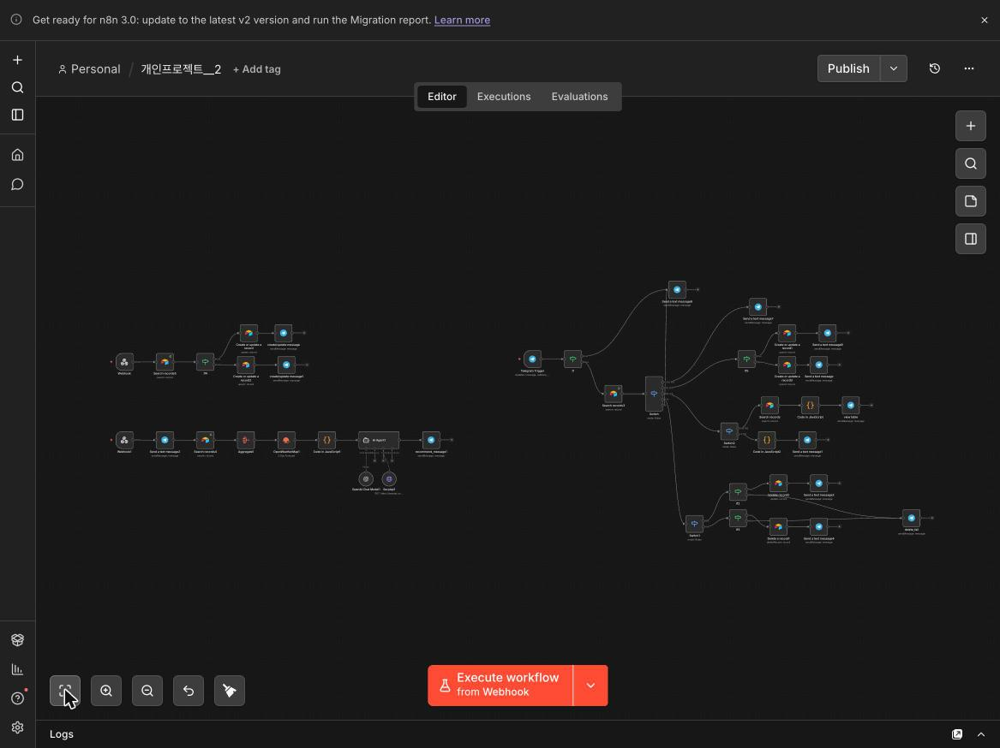
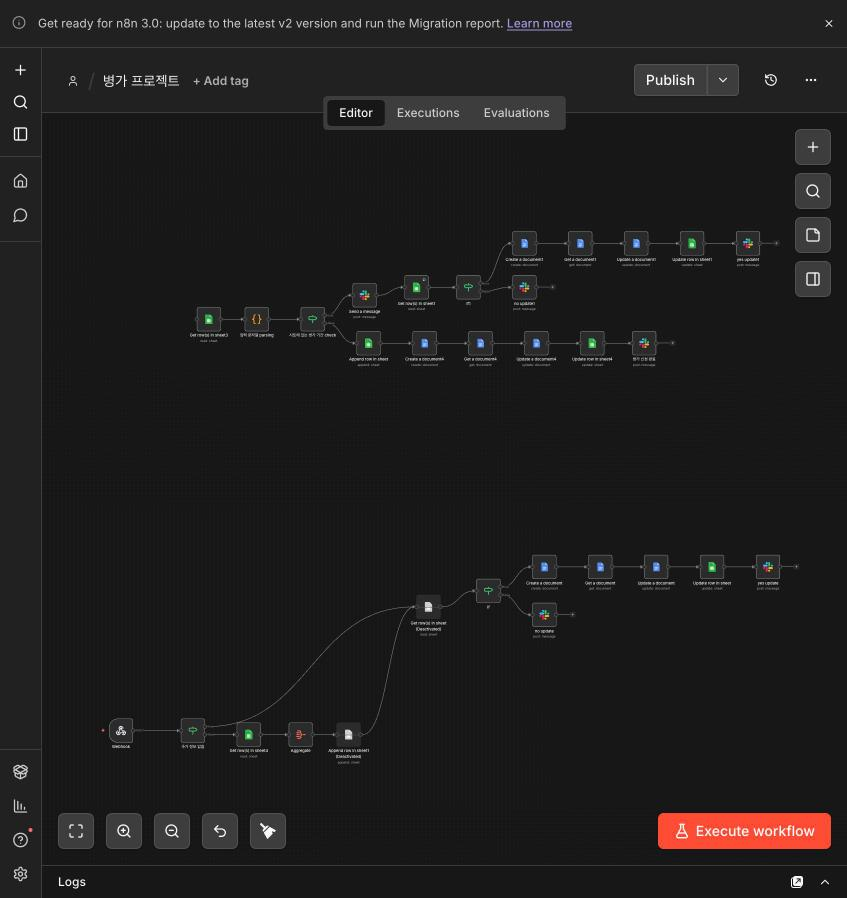
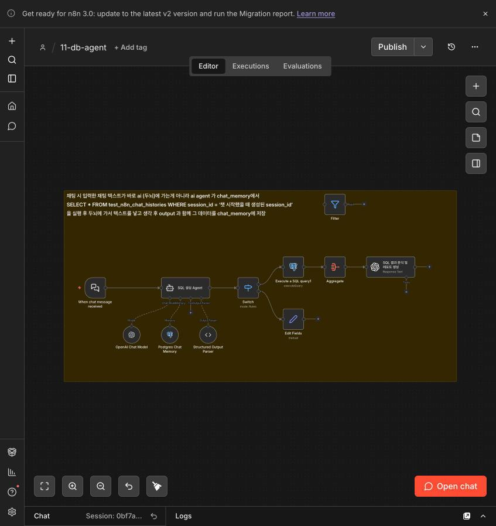
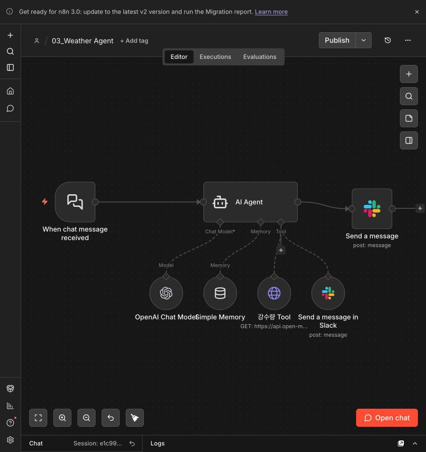
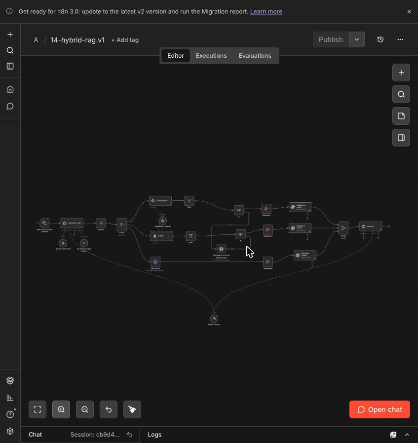
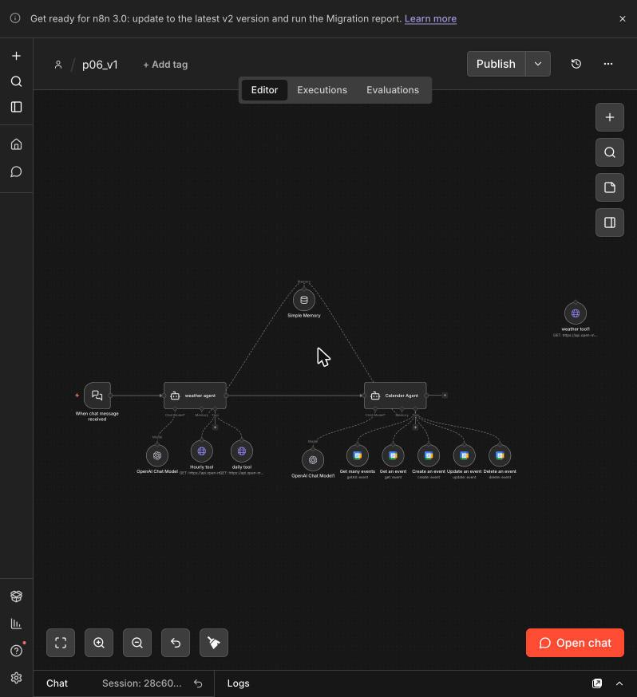
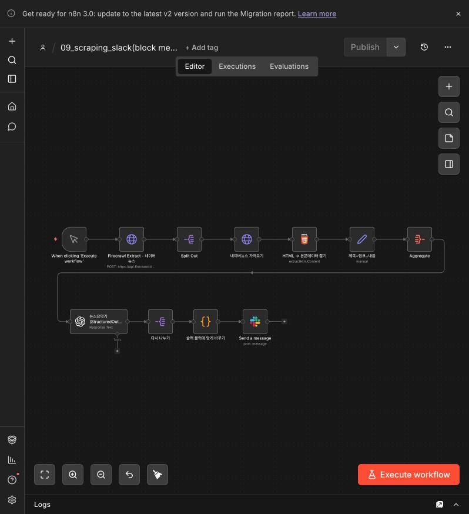

# n8n 업무 자동화 워크플로우

> "고정된 순서로 결과가 재현돼야 하는 일은 **규칙**으로, 요약·판단이 필요한 일만 **AI**로."
> n8n으로 만든 업무 자동화 워크플로우 7개입니다. 각 워크플로우마다 어디까지가 규칙 노드이고 어디서부터 AI 노드인지, 왜 그렇게 나눴는지를 적었습니다.

| # | 워크플로우 | 성격 | 노드 | 연동 |
|---|---|---|---|---|
| 01 | [우리 어디서 봐? — 모임 장소 추천 봇](#01-우리-어디서-봐--모임-장소-추천-텔레그램-봇) · [저장소 ↗](https://github.com/sikumdev/n8n-meetup-place-bot) | 규칙 + AI | 42 | Telegram · Airtable · OpenAI · SerpApi · OpenWeatherMap |
| 02 | [병가 신청 자동화](#02-병가-신청-자동화) | **규칙만** | 31 | Webhook · Google Sheets · Google Docs · Slack |
| 03 | [자연어 → SQL 리포트 에이전트](#03-자연어--sql-리포트-에이전트) · [저장소 ↗](https://github.com/sikumdev/n8n-nl-to-sql-report-agent) | AI + 안전 규칙 | 12 | PostgreSQL · OpenAI |
| 04 | [강수량 알림 에이전트](#04-강수량-알림-에이전트) | AI + 도구 | 7 | Open-Meteo · Slack |
| 05 | [하이브리드 RAG 에이전트](#05-하이브리드-rag-에이전트) | AI | 25 | OpenAI · In-memory Vector Store |
| 06 | [날씨를 보고 일정을 잡는 캘린더 에이전트](#06-날씨를-보고-일정을-잡는-캘린더-에이전트) · [저장소 ↗](https://github.com/sikumdev/n8n-weather-calendar-agent) | 멀티 에이전트 | 14 | Google Calendar · Open-Meteo · OpenAI |
| 07 | [IT 뉴스 3줄 요약 Slack 리포트](#07-it-뉴스-3줄-요약-slack-리포트) · [저장소 ↗](https://github.com/sikumdev/n8n-it-news-slack-digest) | 규칙 + AI(요약만) | 11 | Firecrawl · 네이버뉴스 · OpenAI · Slack |

01 · 03 · 06 · 07은 각자 별도 저장소로도 나눠 두었습니다(표의 **저장소 ↗**). 이 저장소는 전체 목차와 규칙/AI 판단 기준을 모아 보는 곳입니다.

`workflows/*.json`은 n8n에서 **Import from File**로 바로 불러올 수 있습니다. credential과 외부 ID(Airtable base, Google 문서 ID, Slack 채널 ID, API 키)는 모두 placeholder로 바꿔 두었으니 import 후 본인 계정으로 연결하면 됩니다.

---

## 01. 우리 어디서 봐? — 모임 장소 추천 텔레그램 봇

> 📁 별도 저장소: [sikumdev/n8n-meetup-place-bot](https://github.com/sikumdev/n8n-meetup-place-bot)

**문제** — 여럿이 만날 때 "어디서 볼까"는 항상 가장 멀리 사는 사람이 손해를 본다. 핫플레이스가 아니라 **모두의 이동 시간이 비슷한 곳**을 찾고 싶었다.

**흐름**

```
Telegram Trigger
  └─ Switch (명령 분기: 관심 활동 등록 / 출발지 등록 / 현황 조회 / 삭제 / 추천)
       ├─ 관심 활동  → Airtable 저장 → 등록 완료 메시지          ← 규칙
       ├─ 출발지     → Webhook(위치 입력 폼) → Airtable 저장       ← 규칙
       ├─ 현황 조회  → Airtable 조회 → 표 형태로 응답             ← 규칙
       ├─ 삭제       → Airtable 삭제 → 확인 메시지                ← 규칙
       └─ 추천       → 참여자 출발지·관심 활동 Aggregate
                       → AI Agent (SerpApi · OpenWeatherMap 도구) ← AI
                       → 추천 결과 메시지
```

**규칙 / AI 경계**
- 등록·조회·삭제 CRUD는 전부 Switch·If·Airtable 노드. LLM이 끼면 같은 입력에 다른 결과가 나올 수 있어서 뺐다.
- AI는 "출발지 N개 + 관심 활동 + 날씨"를 받아 장소를 고르는 **판단** 단계에만 쓴다.
- 에이전트 프롬프트에 **15분 편차 규칙**을 명시: 가장 오래 걸리는 사람과 가장 적게 걸리는 사람의 이동 시간 차이가 15분 안팎이 되는 역을 우선하고, 벗어나면 무게중심을 먼 사람 쪽으로 옮긴다. 평균이 아니라 **편차**를 줄이는 게 목표.

**배운 것** — 명령 분기를 Switch 하나로 모으니 새 기능을 붙일 때 분기만 추가하면 됐다. 42노드 중 AI 노드는 1개뿐이다.



---

## 02. 병가 신청 자동화

**문제** — 병가 신청이 메신저 → 담당자 수기 기록 → 문서 작성으로 이어지면서 누락과 중복이 생겼다.

**흐름**

```
Webhook (신청 폼)
  └─ If: 추가 정보 없음? ─ 예 → 안내 메시지(Slack)
       └─ 아니오 → 입력 문자열 parsing (Code)
            └─ Google Sheets 조회 → If: 같은 기간 병가 이미 있음?
                 ├─ 있음 → 중복 안내(Slack)
                 └─ 없음 → Sheets 행 추가
                            → Google Docs 신청서 생성 → 내용 채우기 → 확인
                            → Sheets 상태 업데이트 → 완료 메시지(Slack)
```

**규칙만 쓴 이유** — 신청 접수는 **같은 입력이면 항상 같은 결과**여야 한다. 기간 겹침 검사, 문서 생성, 상태 기록 어디에도 판단이 필요한 지점이 없어서 LLM을 한 곳도 쓰지 않았다. 31개 노드가 전부 If·Code·Sheets·Docs·Slack이다.

**설계 포인트**
- 중복 검사를 Sheets 조회 → If로 먼저 걸어서, 문서를 만든 뒤에 중복을 발견하는 일이 없게 했다.
- 처리 결과는 항상 Slack으로 돌려준다(접수 / 중복 / 정보 부족). 사용자가 "됐나?"를 물어볼 필요가 없게.



---

## 03. 자연어 → SQL 리포트 에이전트

> 📁 별도 저장소: [sikumdev/n8n-nl-to-sql-report-agent](https://github.com/sikumdev/n8n-nl-to-sql-report-agent)

**문제** — "지난달 고객 유형별 매출 보여줘" 같은 질문에 매번 SQL을 써주는 일을 줄이고 싶었다. 단, DB를 건드리는 사고는 절대 없어야 한다.

**흐름**

```
Chat Trigger
  └─ SQL 생성 Agent (OpenAI + Postgres Chat Memory)   ← AI: 질문 → SELECT 문
       └─ Filter: 출력에 DROP 포함?  → 차단             ← 규칙
            └─ Structured Output Parser (success / SQL)
                 └─ Switch: success == true?
                      ├─ true  → Execute a SQL query (PostgreSQL)
                      │           → Aggregate → 결과 분석 및 레포트 생성 (OpenAI)
                      └─ false → 질문 보완 요청
```

**안전 장치 (3겹)**
1. **프롬프트** — "데이터 수정/삭제/생성은 어떤 경우에도 금지, 조회만 가능"을 시스템 메시지에 명시하고 테이블 스키마(customers, sales)를 함께 제공
2. **Filter 노드** — LLM 출력에 `DROP` 등 파괴적 키워드가 있으면 실행 노드로 가지 못하게 차단
3. **Structured Output + Switch** — `success`가 true일 때만 실행. 파싱 실패나 생성 실패는 실행 자체가 안 됨

**배운 것** — "LLM이 안 할 거야"에 기대지 않고, LLM 바깥의 규칙 노드로 한 번 더 막는 구조가 필요하다.



---

## 04. 강수량 알림 에이전트

**흐름** — Chat Trigger → AI Agent(Open-Meteo HTTP 도구 + Slack 도구) → Slack 알림

**규칙 / AI 경계** — 에이전트에게 "현재 시각과 가장 가까운 시간대의 강수량을 고르고, 0mm이면 '비 안 옴', 초과면 '우산 챙기세요'"라는 **고정 출력 형식**을 프롬프트로 강제했다. 판단은 거의 없고 도구 호출 순서(시각 확인 → 날씨 조회 → Slack 전송)를 에이전트가 처리하는 형태. 지금 다시 만든다면 이건 규칙 노드로도 충분하다는 게 결론.



---

## 05. 하이브리드 RAG 에이전트

**흐름** — 사용자 입력 → 판단 에이전트(Structured Output: 질문 유형) → Switch로 분기 → 유형별로 다른 모델 호출 → Merge → 최종 답변 에이전트(임베딩 + In-memory 벡터 스토어)

**설계 포인트** — 질문을 먼저 분류한 뒤 필요한 경로만 태운다. 모든 질문에 검색을 붙이면 느리고 비싸서, 검색이 필요한 유형에만 벡터 스토어를 연결했다. 후속 프로젝트([올리브영 리뷰 RAG](https://github.com/sikumdev/oliveyoung-review-insight-rag))에서 이 구조를 LangGraph로 옮기고 pgvector·평가셋을 붙였다.



---

## 06. 날씨를 보고 일정을 잡는 캘린더 에이전트

> 📁 별도 저장소: [sikumdev/n8n-weather-calendar-agent](https://github.com/sikumdev/n8n-weather-calendar-agent)

**문제** — "다음 주 토요일에 야외 모임 잡아줘"는 두 가지 판단이 섞여 있다. 날짜 해석·날씨 확인과, 캘린더 조회·생성. v0에서 하나의 에이전트에 다 맡겼더니 날씨를 보지 않고 일정을 만들거나, 캘린더를 추측으로 답하는 일이 생겼다.

**흐름**

```
Chat Trigger
  └─ weather agent  ← 역할 1: 상대 날짜("이번 주 토요일")를 YYYY-MM-DD로 확정, Open-Meteo(hourly/daily)로 날씨 판단
       │             캘린더는 절대 건드리지 않음
       └─ Calender Agent  ← 역할 2: Google Calendar 도구(조회·생성·수정·삭제)로만 답변
                           툴 호출 없이 추측 답변 금지, 실패 시 실패했다고 말함
```

**설계 포인트 — 역할 분리**
- 에이전트를 둘로 나누고 각자 **하지 말 것**을 프롬프트에 명시했다: weather agent는 "일정 생성이나 캘린더 규칙은 절대 처리하지 않는다", Calender Agent는 "캘린더 요청은 추측하지 말고 반드시 툴 호출 결과로만 답한다".
- 일정 충돌 검사는 Calender Agent가 `Get many events`로 먼저 조회한 뒤 생성하도록 순서를 고정.
- 시간대는 두 에이전트 모두 `Asia/Seoul`로 고정 — 상대 날짜 해석이 어긋나는 가장 흔한 원인이었다.



---

## 07. IT 뉴스 3줄 요약 Slack 리포트

> 📁 별도 저장소: [sikumdev/n8n-it-news-slack-digest](https://github.com/sikumdev/n8n-it-news-slack-digest)

**흐름**

```
Manual/Schedule Trigger
  └─ Firecrawl로 네이버 IT 뉴스 목록 수집 → Split Out → 기사별 본문 요청 → HTML 본문 추출   ← 규칙
       └─ 제목·링크·본문 정리 → Aggregate
            └─ 뉴스요약기 (OpenAI, Structured Output: 3줄 요약)                          ← AI
                 └─ Slack Block Kit 형식으로 변환 (Code) → Slack 전송                      ← 규칙
```

**규칙 / AI 경계** — 수집·추출·전송은 전부 규칙 노드. AI는 **본문을 3줄로 요약하는 한 단계**에만 쓰고, 출력은 Structured Output으로 받아 Slack 블록에 그대로 꽂히게 했다. 요약 품질이 흔들려도 전송 포맷은 깨지지 않는다.



---

## 판단 기준 정리

| 이런 일은 | 이렇게 | 예 |
|---|---|---|
| 같은 입력 → 같은 결과여야 함 | 규칙 노드 (If · Switch · Code) | 병가 중복 검사, 명령 분기, CRUD |
| 요약·추천·분류처럼 판단이 필요함 | AI 노드 | 장소 추천, SQL 생성, 뉴스 요약, 질문 유형 분류 |
| AI 출력이 외부에 영향을 줌 (DB 실행, 메시지 발송) | AI 뒤에 **규칙 검문소** 추가 | DROP 필터, success 스위치, Structured Output |
| 판단 종류가 둘 이상 섞임 | 에이전트를 역할별로 분리, 각자 "하지 말 것" 명시 | 날씨 판단 ↔ 캘린더 편집 |
| 결과를 사람이 확인해야 함 | 마지막에 알림 (Slack · Telegram) | 모든 워크플로우 |

## 사용

1. n8n → Workflows → Import from File → `workflows/0X_*.json`
2. 각 노드의 credential을 본인 계정으로 연결
3. placeholder 교체: `AIRTABLE_BASE_ID` `AIRTABLE_TABLE_ID` `GOOGLE_FILE_ID` `SLACK_ID` `YOUR_API_KEY` `user@example.com`(캘린더 ID)

## 환경

n8n (self-hosted, Docker) · OpenAI · PostgreSQL · Airtable · Google Calendar · Google Workspace · Slack · Telegram Bot API · Firecrawl · Open-Meteo
